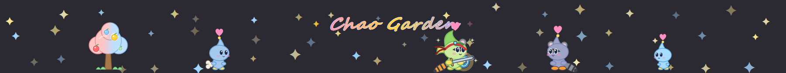

# Claude Chao Garden



A little chao garden that lives above the typing box in the Claude desktop app. Chao hatch from eggs, grow up and evolve from the work Claude does in your chats, find a class, and fight corrupted omochao right on the garden. It is a Claude Code mod: it runs on your own computer and adds nothing to what is sent to Claude.

## What happens in the garden

- **Eggs hatch** after you send 8 messages, or 2 hours after they were laid. The garden starts with two eggs and holds up to eight chao.
- **Claude's work ripens coloured fruit** on the tree: Claude's commands ripen red fruit (Power), reading ripens blue (Swim), edits ripen green (Run), and its replies ripen yellow (Fly). At the end of each of Claude's turns the ripe fruit go to the chao that like that colour most, and one falls from the tree for a chao to walk over and eat.
- **Each chat grows a new tree.** How Claude worked in that chat makes it a plain, twin or rainbow tree, which changes what its fruit give.
- **Growing up**: a garden day passes on each day you open a chat. Babies become children, and a well-fed child makes a cocoon and comes out as one of 15 adult forms: Hero, Dark or Neutral (from the hours you chat, and petting), and Normal, Swim, Fly, Run or Power (from its biggest stat; the next biggest can show on top).
- **Classes**: adults find a class from their strongest stat: Healer (Swim), Warrior (Power), Ranger (Run) or Wizard (Fly), with gear that gets better as they level up.
- **Fights**: every so many messages, or when one of Claude's commands fails, a corrupted omochao wanders in and up to four hatched chao fight it on their own. Wins train them and leave a trophy. Late nights, new moons and very long chats bring a tougher challenger once a day.
- **Animals and eggs in chat**: now and then a message carries an animal (🦝 🐧 🐰 ...) or an egg 🥚 just under it. Click the animal to give it to a chao (it takes on a part, like a tail or ears) or click the egg to add it to the garden.

The garden never pops up, asks or notifies: you play it only when you want to.

## Install

At the prompt of a Claude Code terminal session:

```
/plugin install chao-garden --marketplace lunabeanbean/ClaudeChaoGarden
```

Answer `y` to add the marketplace, then pick a scope (the user scope makes it load everywhere).

From a shell:

```
claude plugin install chao-garden --marketplace lunabeanbean/ClaudeChaoGarden
```

In the desktop app, where `/plugin` does not run: click **+** next to the prompt box, then **Plugins**, **Add marketplace** with `lunabeanbean/ClaudeChaoGarden`, then **Add plugin**.

The garden band shows in the **Claude desktop app**. In a terminal session `/chao` still works, but there is no band.

## Commands

```
/chao                              the garden, each chao's card, the fruit meters and fights
/chao name <old name> > <new name> rename a chao
/chao pet [name]                   pet a chao
/chao pace <slow|normal|fast>      how fast they grow (1 chao year = 5, 3 or 1 garden days)
/chao garden <on|off>              show or hide the band (your chao keep growing)
/chao fight                        the last fight, move by move
/chao fight now                    a practice fight (no rewards)
/chao fight <off|on>               stop or allow the fights that start on their own
/chao fight every <n>              about how many messages apart the wild omochao come
/chao team [<name>, <name>|clear]  who fights, and who always goes in front
/chao reset confirm                start the garden over with new eggs
```

## Your name

When a chao is happy it says "I love you!". To have it use your name, set the mod's **Your name** option in the config menu, or in `~/.claude/settings.json`:

```json
{ "pluginConfigs": { "chao-garden": { "options": { "name": "Sam" } } } }
```

## Notes

- The garden is saved on your computer (the mod's own store under `~/.claude/plugins/store/`) and carries across chats.
- It works alongside other mods. It adds its animal and egg buttons under whatever draws the message, and it draws the band above the typing box itself.

Unofficial fan project. Chao and Omochao are from Sega's Sonic the Hedgehog games; this mod is not affiliated with or endorsed by Sega. All drawings in it are original.

## Licence

MIT, see [LICENSE](LICENSE).
